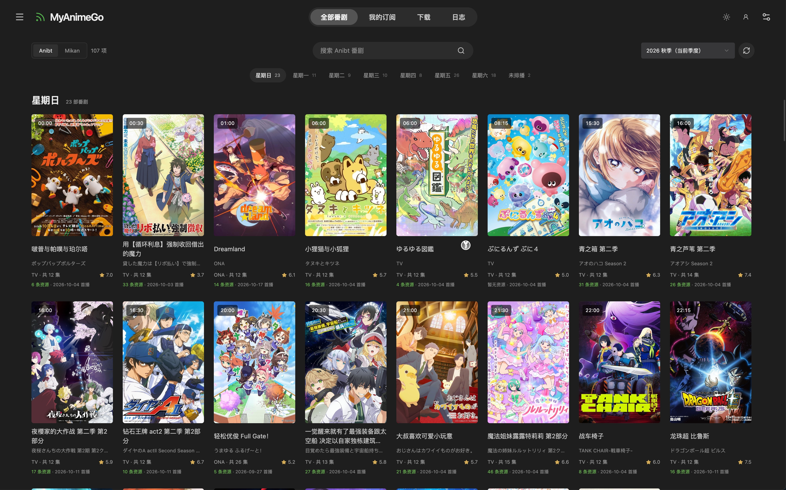
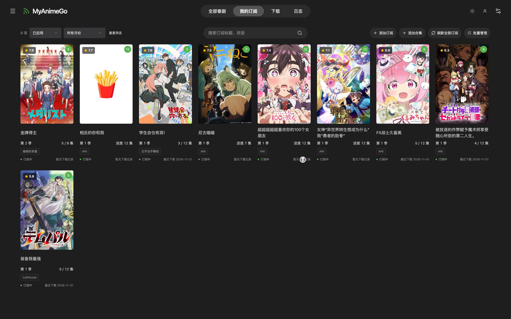
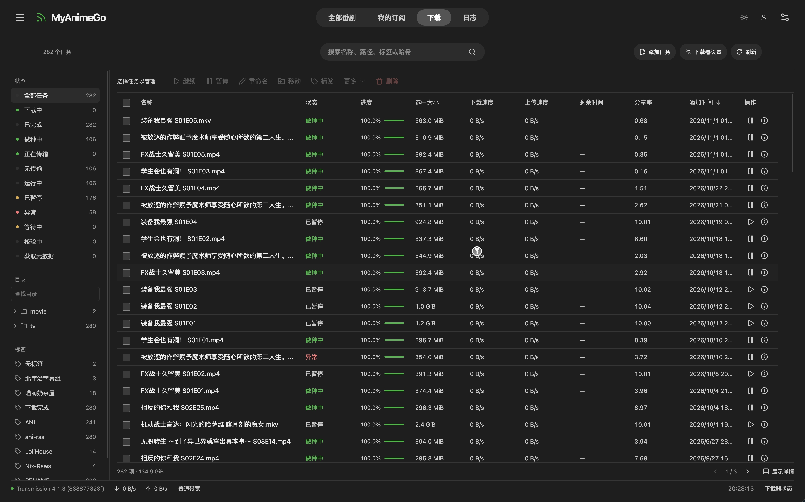
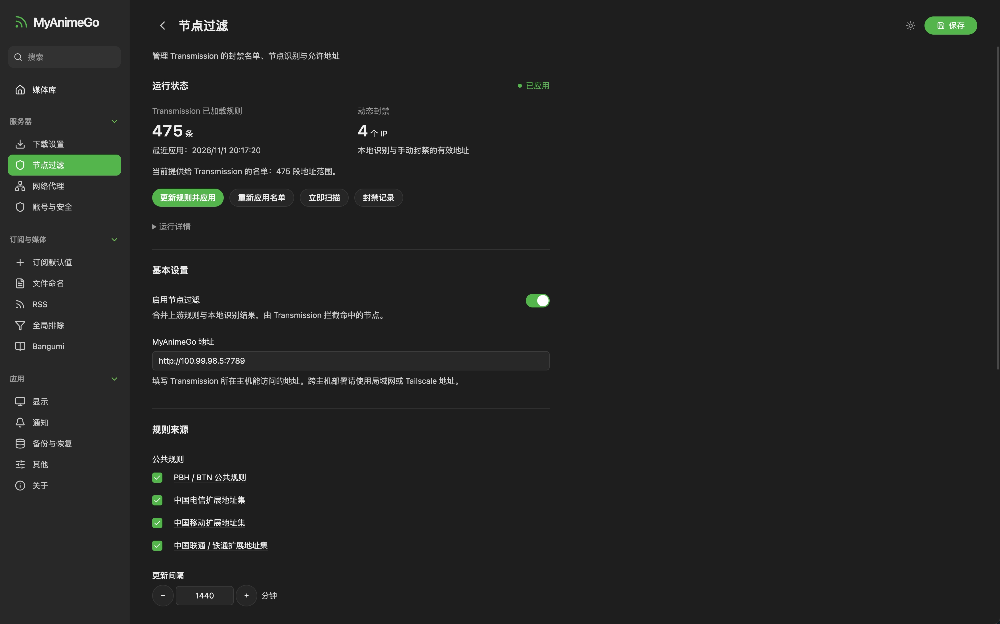

# MyAnimeGo

* 基于 [ani-rss](https://github.com/wushuo894/ani-rss) 改造的自动追番工具，使用 Go、Vue 3、shadcn-vue 和 Tailwind CSS。
* 代码全部由 codex + gpt 6.1 sol 生成。

<table>
  <tr>
    <td width="50%"></td>
    <td width="50%"></td>
  </tr>
  <tr>
    <td width="50%"></td>
    <td width="50%"></td>
  </tr>
</table>

## 特色

### 重构

- **Go 后端与前端内嵌**：重写后端，整理为 `backend/` 与 `frontend/`；生产环境通过一个二进制提供 API 和网页。
- **全新海报墙与移动布局**：以 Emby 风格重构 Vue 界面，支持明暗主题；Anibt 优先，Mikan 可切换，按星期定位番剧，悬浮添加订阅。

### 新增

- **内置 Transmission 管理界面**：通过 RPC 管理任务、文件、目录、标签、队列与下载器设置，提供右键菜单、正则批量重命名和修改预览；手机使用独立列表与触摸菜单。
- **节点过滤**：合并 PBH/BTN 公共规则及运营商地址集，支持客户端识别、临时封禁、允许地址和定时更新，下发至 Transmission；需要 Transmission 4.1+。

### 精简

- 下载器只保留 **Transmission**，通知只保留 **Webhook 与 Emby 媒体库刷新**。
- 移除内置视频列表与播放、媒体刮削和 Plex 模式，播放与刮削交给 Emby；保留集数识别、资源筛选与文件命名。
- Bangumi 用于公开资料查询，取消收藏读取、观看进度同步和点格子等账号联动。
- 移除摸鱼检测、ICS 导出、自定义 CSS/JS、上传前端包、GitHub Token、内置自动更新及应用内开机自启管理；服务自启交给 systemd 等部署工具。

### 优势

- **内存占用更少**：原版3.x内存占用300多M, 1.X 100多M , go 版大概只需要50M。
- **专注于Transmission下载器**：砍掉qb以及一些我不用的功能, 集成下载管理器, 可以封禁pcdn地址, 批量重命名子文件夹的文件。

## 构建与部署

可直接从 [Releases](https://github.com/jqtmviyu/MyAnimeGo/releases) 下载对应系统的压缩包，解压后运行。支持 Linux amd64 / arm64 / armv7、Windows amd64 / arm64、macOS amd64 / arm64；前端均已内嵌，macOS 发布包为命令行版本。

需要 Go 1.25+、Node.js 22.12+、pnpm 12 和 Python 3。在仓库根目录执行：

```bash
bash scripts/build.sh
./dist/myanimego serve -listen 0.0.0.0:7789 -data-dir ./data
```

打开 `http://服务器地址:7789`，初始账号和密码均为 `admin`，登录后修改。前端已内嵌，部署和升级只需替换二进制、保留数据目录；发布包同时附带许可证。Windows 程序名为 `myanimego.exe`。

Linux ARM64 构建：

```bash
MYANIMEGO_OUTPUT_DIR="$PWD/dist/linux-arm64" CGO_ENABLED=0 GOOS=linux GOARCH=arm64 bash scripts/build.sh
```

GitHub Actions 仅在推送 tag 或手动运行时构建。前端构建一次，各架构并行编译；全部成功后发布到对应 tag 的 Release，附带许可证和 `SHA256SUMS`。同一 tag 可重新构建并覆盖附件，手动运行时填写已有标签（如 `0.1`）。

## 开发运行

终端一：

```bash
cd backend
go run ./cmd/myanimego serve -dev -data-dir ./data/development -listen 127.0.0.1:7789
```

终端二：

```bash
cd frontend
pnpm install --frozen-lockfile
SERVER_HOST=http://127.0.0.1:7789 pnpm dev --strictPort
```

访问 [http://127.0.0.1:37789](http://127.0.0.1:37789)。Vite 支持热更新，`/api` 转发至 Go；`-dev` 提供自动任务总暂停与审核入口，生产运行时省略。

## 配置与数据

- Transmission 连接和路径：设置 → 下载设置；公共规则与封禁：设置 → 节点过滤。
- 数据保存在 `-data-dir`，界面提供备份恢复；手动复制数据前先停止服务。
- 源码分为 `frontend/` 和 `backend/`，构建脚本位于 `scripts/`。
- systemd、媒体路径映射、旧数据导入及其他启动参数见 [后端说明](backend/README.md)。

## 开源协议与致谢

- **MyAnimeGo**：由 jqtmviyu 维护，沿用 [GNU GPL v2](LICENSE)。
- [ani-rss](https://github.com/wushuo894/ani-rss)：项目上游，保留原作者 **wushuo894** 及贡献者署名。
- [qBittorrent-ClientBlocker](https://github.com/Simple-Tracker/qBittorrent-ClientBlocker)：Transmission 节点识别与名单下发机制参考；[MIT 许可](LICENSES/qBittorrent-ClientBlocker-MIT.txt)，Copyright (c) 2023 Simple-Tracker。
- [TrguiNG](https://github.com/openscopeproject/TrguiNG)：Transmission 功能与 RPC 交互参考。
- [PeerBanHelper](https://github.com/PBH-BTN/PeerBanHelper)：节点过滤机制参考。
- [BTN-Collected-Rules](https://github.com/PBH-BTN/BTN-Collected-Rules)：公共规则数据，采用 [CC BY 4.0](LICENSES/BTN-Collected-Rules-CC-BY-4.0.txt)。
- [autorosvpn](https://github.com/zealic/autorosvpn)：运营商地址集，采用 [MIT](LICENSES/autorosvpn-MIT.txt)。
- **Emby**：界面布局与配色参考。

来源、使用方式及依赖许可详见 [LICENSES](LICENSES/README.md)。
